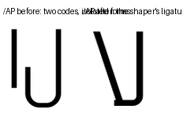
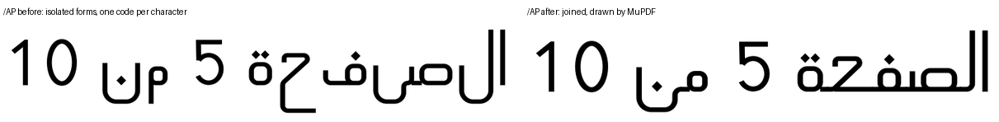
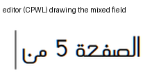
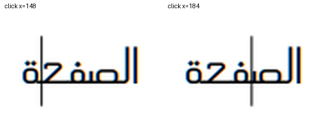

# ٢٦ · النتيجة: العنقود لكل محرف — كل كلمة ترسم في محلها

| | |
|---|---|
| **نقطة التثبيت** | PDFium `8bca5ad` · سجلّ القياس: آخر إيداع قبل هذا العمل |
| **الرأس المقيس** | PDFium `11b63d8` |
| **الوحدة** | اختبارات ١٢٦٣/١٢٦٣ · الهارنس ٩/٩ `RESULT PASS` |
| **الاستشارة** | `25-claude-clusters.md` · الخطة `24-plan-clusters.md` |

## ١ · العيب وأصله

`ShapeRun` لم يكن يملأ `ShapedGlyph::cluster` (`cpvt_shaping.cpp:89` قبل التغيير)، فكان كل معرّف
يعود بقيمة `٠`. `ShapeRtlRun` يبني العناقيد من تلك القيمة، فصار المقطع كله عنقودًا واحدًا يُعلَّق على
**آخر** محرف منطقي فيه: كلمة واحدة تحمل تقدّم المقطع كله ومعرّفاته، وكل كلمة أخرى `fShapedAdvance = 0`
بلا معرّفات. النتيجة المقيسة: المؤشّر يقفز فوق المقطع كله، والنقر لا يفرّق بين حروفه، ومقطع يعبر سطرًا
يُرسم كاملًا على سطر واحد.

## ٢ · ما تغيّر (بـ`file:line` على `11b63d8`)

| الملف | التغيير |
|---|---|
| `core/fpdfapi/font/cpdf_shaping.cpp:84` | `hb_buffer_set_cluster_level(MONOTONE_GRAPHEMES)` صريحًا — الافتراض الذي يقرأ التخطيط العناقيد به |
| `core/fpdfapi/font/cpdf_shaping.cpp:102-124` | `ShapeRun` يرفض مقطعًا خارج الترتيب الرتيب (يكتب قيم `cluster` ويرفض ما لا يستطيع التخطيط وضعه) |
| `core/fpdfapi/font/cpdf_shaping.cpp:128` | `GroupClusters`: كل قيمة عنقود تُمتدّ إلى **أول قيمة أعلى منها**، بقاعدة HarfBuzz: «Each character belongs to the cluster that has the highest cluster value not larger than its initial cluster value» |
| `core/fpdfdoc/cpvt_section.cpp:512` | `ShapeRtlRun` يستعمل `GroupClusters`؛ الاختصار والرفض في مكان واحد بدل حلقة عناقيد ثانية |
| `core/fpdfdoc/cpvt_section.cpp:585` | **أول** محرف في العنقود يملك تقدّمه ومعرّفاته (كان آخرها) |
| `core/fpdfdoc/cpdf_generateap.cpp:413-450` | إصدار المقطع ككتلة واحدة: كلماته بعكس الترتيب المنطقي (ترتيب المشكِّل) بخطّ نسخة يعرف معرّفاته `flush_pending` |
| `core/fpdfdoc/cpdf_generateap.cpp:418` | أصل السطر يُكتب قبل أي مقطع (`flush_pending`)، فلا يبقى في المخزن سطرٌ لم يُكتب |
| `core/fpdfdoc/cpvt_fontmap.cpp:144` | `CreateShapedFontAlias`: نسخة من خطّ الحقل تحمل `/ToUnicode` لمعرّفات التشكيل (ISO 32000-1، 9.10.3)، تُضاف إلى موارد الدفق تحت اسم خاص |
| `core/fpdfdoc/cpvt_section.cpp:590-606` | القسم يسجّل محارف كل معرّف حين يشكّل (`shaped_chars_`) |
| `core/fpdfdoc/cpvt_section.cpp:397-436` | `SearchWordPlaceImpl`: صندوق أقرب مركزًا + الجهة حسب اتجاه الكلمة (البحث الثنائي كان يفترض صعود الفهرس مع x) |
| `core/fpdfdoc/cpvt_section.cpp:786` | كلمة تقدّمها صفر لا تُسبب كسر سطر: هي بقيّة عنقود حبره عند من قبله |
| `core/fpdfdoc/cpvt_word.h:45-47,75` | `CPVT_Word` يملك نسخة من معرّفاته بدل span على مصفوفة يُعاد بناؤها كل تخطيط |
| `core/fpdfdoc/cpvt_wordinfo.h:35` | `nShapedRun` = هوية المقطع على الكلمة |
| `core/fpdfapi/font/hb_scoped_types.h` | أنواع HarfBuzz بملكية RAII، يستعملها المشكِّل و`cpdf_fontsubsetter.cpp` معًا |
| `core/fpdfapi/font/` | وحدة التشكيل انتقلت من `core/fpdfdoc` إلى طبقة الخط، وبُنيت معها مكتبة HarfBuzz بدل `fpdfdoc` |

## ٣ · القياسات

### ٣.١ الأكواد في الـAP = مخرج HarfBuzz مقطعًا بمقطع

```
$ scripts/pdfium_fields/run.sh --out /tmp/check-run --baseline-probe /tmp/fields/field_probe.before
mixed  codes=[1, 38, 53, 110, 85, 131, 27, 847, 1, 141, 135, 1, 843, 842]
       expected=[1, 38, 53, 110, 85, 131, 27, 847, 1, 141, 135, 1, 843, 842]      RESULT PASS
q0     codes=[38, 53, 110, 85, 131, 27]      (ترتيب HarfBuzz البصري، لا المنطقي)
```
(مُثبت — الأمر أعلاه.)

### ٣.٢ كل حرف في موضعه: مواضع الأكواد في «الصفحة»

| الكود | المحرف | `x` في الـAP | `x` على الصفحة |
|---|---|---|---|
| `0x0026` | ة | 1.000 | 141.0 |
| `0x0035` | ح | 12.448 | 152.4 |
| `0x006E` | ف | 27.400 | 167.4 |
| `0x0055` | ص | 38.656 | 178.7 |
| `0x0083` | ل | 56.944 | 196.9 |
| `0x001B` | ا | 63.064 | 203.1 |

المجموع ٦٢٫٠٦ نقطة = مجموع تقدّمات المشكِّل (لا تقدّمات الأشكال المنفردة). (مُثبت — استخراج
`Td`/`Tj` من `/AP` بأمرٍ في §٥.)

### ٣.٣ المؤشّر صار لكل محرف

`form_render` بحقل `q0` مُركَّزًا، ونقرة واحدة بموضع مختلف في كل صورة؛ عمود المؤشّر (عمود حبر بطول
السطر) عند:

| النقرة | 148 | 160 | 172 | 184 | 196 |
|---|---|---|---|---|---|
| عمود المؤشّر | 152 | 167 | 167 | 178 | 197 |
| الموضع المحسوب من §٣.٢ | 152.4 (ح) | 167.4 (ف) | 167.4 (ف) | 178.7 (ص) | 196.9 (ل) |

أي أن المؤشّر يقع على حدّ المحرف الذي نُقر فيه، لا على حدّ المقطع. (مُثبت — الصور أدناه.)

### ٣.٤ الصور






### ٣.٥ المحرّر والـAP يرسمان الحبر نفسه في المكان نفسه

```
$ scripts/pdfium_fields/run.sh …    (مرحلة "editor against the appearance stream")
ar   editor 283..297 | appearance 285.0..298.0
q0   editor 2..66    | appearance 3.0..66.0        RESULT PASS
```
الفرق ≤ ٢ نقطة، وهو نصف بكسل عند ٧٢ نقطة/بوصة في كل اتجاه. (مُثبت.)

### ٣.٦ النصّ المستخرَج يعود بالمحارف

```
$ .venv/bin/python scripts/pdfium_fields/measure_text.py after.pdf --pdfium-out ~/pdfium/pdfium/out/Release
ar           text='لا'
q0           text='الصفحة'
ltr_mixed    text='abc الصفحة def'
mixed        text='الصفحة 5 من 10'         RESULT PASS
```
وعلى `11b63d8` (حين كان الاستخراج يعتمد `/ActualText`، قبل نسخة الخطّ): `mixed` كان يعود
بمسافة في غير موضعها، وعلى بناء `c3` (بلا `/ActualText` ولا نسخة خطّ) كان `ar` → `Ò` و`q0` →
`&5nU\u0083ا`، والمرحلة `FAIL` — فالحارس يعضّ. (مُثبت.)

### ٣.٧ ما لم يتغيّر

- اختبارات الوحدة: **١٢٦٣/١٢٦٣** (كانت ١٢٤٢: +٧ لعناقيد، +١ للنقر، +٨ لبوابة التشكيل،
  +٤ لنسخة الخطّ، +٢ لموضع السطر الثاني ومقطع RTL داخل فقرة LTR).
- الضوابط: `latin` و`nonidentity` بايت-ببايت كما في خط الأساس؛ `q0` هامشه الأيسر لم يتحرّك؛
  `center` مركزه ٩١٥٫٠ → ٩١٥٫٠.
- الصورة قبل/بعد: الحبر نفسه في المكان نفسه (فرقٌ على حدود الحبر بسبب تجزئة الرسم فقط).

## ٤ · قراران: لا سجلّ `ShapedRun`، ونصّ المقطع بخطّ يسمّي معرّفاته

**الثاني** (بعد جولة المراجعة، `27-review-round.md` §١): الـAP لا يحمل `/ActualText`؛ المقطع
يرسم بخطّ نسخة يحمل `/ToUnicode` يغطي معرّفاته. السبب مصفوفة القرّاء: `ActualText` منطقي يقلبه
poppler، ومعرّف بلا `ToUnicode` يفقده كل قارئ. والقياس: الرسم لم يتغيّر بكسليًّا بين البناءين.

**الأول** (قرار التصميم الأصلي):

التصميم السابق كان يبني `struct ShapedRun {first_word, count, x, y, glyph_begin, glyph_count}` لأن أصل
المقطع كان يُستنتج من العناقيد فيعطي أصلًا سالبًا. بعد التوزيع لكل محرف لم يبقَ استنتاج: كل كلمة تحمل
موضعها من `position_word` (`cpvt_section.cpp:871`) والإزاحة نسبةً إلى العنقود (`cpvt_section.cpp:568`)،
فـ`word.x + glyph.x_offset·size` صحيح بلا طرح. وسجلٌّ فيه `x`/`y` يكرّر ما تحمله الكلمات ويشقّ على
مقطع يعبر سطرًا (أصل واحد لسطرين) — وهو التحذير نفسه في `25-…` §١-د. الذي احتاجه الإصدار فعلًا هو
**هوية** المقطع لا هندسته، فحُمِل `nShapedRun` على الكلمة.

## ٥ · أوامر إعادة القياس

```bash
# PDFium
cd ~/pdfium/pdfium
third_party/ninja/ninja -C out/Release field_probe form_render pdfium_unittests text_probe
./out/Release/pdfium_unittests                        # 1250/1250

# الهارنس (٩ مراحل)
cd ~/Projects/pdf-gold-standard-fix
scripts/pdfium_fields/run.sh --out /tmp/check --baseline-probe /tmp/fields/field_probe.before

# مواضع الأكواد في /AP
.venv/bin/python - <<'PY'
import re, pikepdf
pdf = pikepdf.open("/tmp/check/after.pdf")
for a in pdf.pages[0]["/Annots"]:
    if str(a["/T"]) == "q0":
        c = bytes(a["/AP"]["/N"].read_bytes()).decode("latin-1"); pen = 0.0
        for m in re.finditer(r"(-?[\d.]+) 0 Td|<([0-9A-F]+)>\s*Tj", c):
            if m.group(1): pen += float(m.group(1))
            else: print(f"0x{m.group(2)} x={pen:.3f}")
PY
```

## ٦ · ما لم يُثبت (وحدوده)

1. **`mixed` يستخرج بمسافة واحدة في غير موضعها** (« الصفحة 5 من 10» بدل «الصفحة 5 من 10»). السبب
   مقيس: PDFium يضع نصّ التسلسل المُعلَّم عند أول كائن نصّي فيه (`cpdf_textpage.cpp:1016-1063`)، فمسافة
   تقع في الطرف البصري للمقطع تخرج في أوّله. الأحرف كلها صحيحة، والترتيب المنطقي صحيح. حارس
   `measure_text.py` يقارن بعد تطبيع المسافات ويعلن ذلك في رأسه.
2. **قرّاء غير PDFium**: الثلاثة يُستخرجون `ar` و`q0` و`ltr_mixed` و`mixed` بترتيبها المنطقي
   عدا موضع واحد: MuPDF يقرأ حرفَي الليجاتور «لا» بالترتيب البصري (`0627 0644`)، لأنه لا يقلب
   محارف المقطع كما يقلبها PDFium وpoppler. المصفوفة الكاملة والسبب في `27-review-round.md` §١.
3. **حدود الكسر داخل العنقود**: الحارس يمنع الكسر قبل كلمة تقدّمها صفر، لكن الانكسار عند موضع
   غير آمن داخل المقطع (بين حرفين متصلين) يحتاج إعادة تشكيل حافة السطر عبر
   `HB_GLYPH_FLAG_UNSAFE_TO_BREAK` — مؤجَّل باسمه.
4. **تحرّك المؤشّر بالأسهم** ما يزال بمحرف لا بعنقود (قد يقف داخل عنقود علامة). مؤجَّل باسمه.
5. **المحرّر يلفّ `mixed`** على سطرين لأن plate المحرّر أضيق من الحقل، والـAP لا يلفّ — سلوكٌ موجود
   قبل هذا التغيير (مقيس على `8bca5ad`: السطر الثاني «10» عند y ٥٨٠–٦٢٠ في البناءين). ولذلك لا تقارن
   مرحلة `measure_editor` إلا الحقول التي تسع سطرًا واحدًا.
6. **`pdfium_embeddertests`**: ١١ فشلًا، وهي نفسها على `8bca5ad` بلا هذا التغيير (مقيس بإخفاء العمل) ⇒
   ليست من هذا التغيير.
