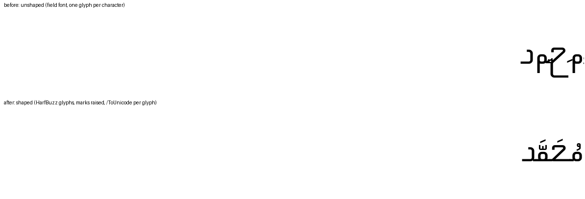

# ٣٠ · النتيجة: محارف كل معرّف في عنقود العلامات

| | |
|---|---|
| **الالتزام** | `452c997` على `7940c93` |
| **المصدر الرسمي** | HarfBuzz Manual، `hb_buffer_cluster_level_t` + «Working with HarfBuzz clusters» |
| **الاختبارات** | ١٢٦٨/١٢٦٨ · الهارنس ٩/٩ · بناء بلا تحذير |
| **الرسم** | `ap/mx/ltr/ct-after.png` مطابقة `sha256` لِـ`7940c93` ⇒ لم يتغيّر بكسل |

## ١ · ما كان وما صار

| | قبل | بعد |
|---|---|---|
| الحقل «مُحَمَّد» (٨ محارف) | ٤ عناقيد · ٨ معرّفات · كل معرّف ← نصّ عنقوده | ٤ عناقيد للتخطيط + ٧ عناقيد للحبيبات · ٨ معرّفات · كل معرّف ← محرفه |
| المستخرج | ٢٧ محرفًا (تكرار) | ٨ محارف، كلٌّ مرّة واحدة |

```
$ ./out/Release/text_probe /tmp/m2-voc.pdf
chars=22 text=\u062F\r\n\u064E\r\n\u0651\r\n\u0645\r\n\u064E\r\n\u062D\r\n\u064F\r\n\u0645
```

٢٢ = ٨ محارف + ٧ فواصل أسطر × ٢ (`\r\n`). والمحارف الثمانية هي «د َ ّ م َ ح ُ م» — أي
مُحَمَّد نفسها، كل محرف مرة واحدة، بترتيب بصري لأن العلامات تُرسم على أساس مرتفع.

## ٢ · الآلية: تمريرتان، لا تمريرة أوسع

المستوى ٠ يدمج العلامة في عنقود أساسها (Manual، level 0)، وهذا ما يحتاجه **التخطيط**: العنقود
هو وحدة المحرف الرسومية التي يعتمد عليها المؤشّر والتحديد وكسر الأسطر. والمستوى ١ يعطي كل علامة
عنقودها (Manual: «non-base characters are initially assigned their own cluster values … the
output is still monotone, but the cluster values are more granular»)، وهذا ما يحتاجه
**الترقيم** ليعرف محرف كل معرّف.

فالتغيير: `ShapeRun` صار يشكّل مرّتين — مرة بالمستوى ٠ للتخطيط (كما كان)، ومرة بالمستوى ١
لتسمية المعرّفات. ولا يُشترط أن تتفقا في المعرّفات: مستوى العناقيد لا يختار المعرّفات، بل يقرأه
HarfBuzz حيث تُدمج العناقيد وتُعكس (قياس في شجرة `third_party/harfbuzz`)؛ فإن فشلت التمريرة
الثانية بقي المقطع مرسومًا بلا أسماء، ولم يعد المقطع إلى نصّه.

وما لا يقوله المستوى ١: **أيّ العلامتين أيّ** — فهو يدمج عنقودي علامتين إذا أعاد ترتيبهما
(قياس: معرّفان كلاهما يُبلّغ عن المحرف ٥). الجواب عند الخطّ نفسه:
`hb_font_get_nominal_glyph(font, ch, &gid)` — المحرف الذي معرّفه الأصلي أحد معرّفات العنقود هو
ما يرسمه ذلك المعرّف. وهذا يعالج العلامات المرتّبة، ويترك الأشكال السياقية (التي لا معرّف أصلي
لها) على تمريرة الحبيبات أو على نصّ العنقود، موثَّقًا.

## ٣ · ما يقيسه الهارنس الآن

`measure_text.py` فيه بوّابتان:

| النوع | الحقول | المقارنة |
|---|---|---|
| نصّي دقيق | `ar` · `q0` · `ltr_mixed` · `mixed` | النصّ كاملًا بعد تطبيع المسافات الطرفية |
| محارف فقط | `vocalized` | **نفس مجموعة المحارف** (٨ محارف)، مع تجاهل فواصل الأسطر |

السبب مكتوب في رأس الملف: العلامة تُرسم فوق أساس السطر، وصفحة نصّ PDFium تبدأ سطرًا جديدًا عند
محرف مرتفع — فالترتيب والفواصل من القارئ لا من الدفق. ما يستطيع الدفق أن يضمنه، ويُقاس: كل محرف
مرة واحدة، ولا محرف مفقود ولا مكرّر.

## ٤ · مراجعة Claude للخطة، وما تغيّر بسببها

استُشرت الخطة قبل التنفيذ (`claude -p --model opus --effort medium`). أهمّ ما ردّ به، وما فعلته:

| ملاحظة Claude | القرار |
|---|---|
| «لا تُحوّل التخطيط إلى المستوى ١» | أُخذت: التمريرتان — التخطيط يبقى على ٠ |
| «استعمل `/ActualText` بدل خريطة لكل معرّف» | **لم يُؤخذ**: مقيس في `27` §١ أن poppler يعكس مقطع `ActualText` المنطقي، فتعود مشكلة القرّاء الثلاثة |
| «اربط المعرّف بالمحرف بالهوية (`hb_font_get_nominal_glyph`) لا بالموضع» | أُخذت — وهي جوهر الحل |
| «لا تُسطّح فواصل الأسطر في الهارنس» | أُخذ جزئيًا: لا تُسطَّح، لكن البوابة تُقارن المحارف لأن الفواصل من القارئ — وموثَّق |
| «لا تكرّر المحرف في حالة التفكيك» | أُزيل التكرار: البديل هو تمريرة الحبيبات ثم نصّ العنقود، بلا فراغ (PDFium يرفض `<>` ويعود إلى الرمز نفسه — مقيس) |
| «قاعدة كسر السطر يجب أن تكون من خصائص Unicode لا من العرض» | مؤجَّل: التخطيط بقي على المستوى ٠، فذيل العنقود (`nShapedGlyphCount == 0`) لا يزال صحيحًا؛ والعلامات لا تصير رؤوس عناقيد |
| «استعمل `HB_GLYPH_FLAG_UNSAFE_TO_BREAK`» | خارج النطاق: كسر الكلمات الطويلة داخل الكلمة عيب سابق في `SplitLines` لا يمسّه هذا التغيير، ويُسجَّل |

## ٥ · صورة الفحص البشري



أعلى: البناء غير المعدَّل — أشكال منفردة والعلامات مبعثرة. أسفل: هذا الفرع — حروف متّصلة وعلامات
فوقها. القياس الكمّي في §١.

## ٦ · جولة المراجعة على هذا التغيير (`452c997` ← `126fdf4`)

ثلاثة مقاعد قرأت `7940c93...452c997`: `APPROVE WITH FIXES` · `REQUEST CHANGES` · `APPROVE WITH FIXES`.
أهمّ ملاحظة كانت **P1 حقيقية قاسها مقعد Spec**: عنقود فيه ليجاتور وعلامة («لَا» = ٣ محارف، ٢ معرّفان)
كان يسمّي الليجاتور بمحرف واحد ⇒ **يسقط حرف**. أُصلح بالإصلاحات التالية:

| الملاحظة | الإصلاح في `251e2a2` |
|---|---|
| P1: ليجاتور + علامة يفقد حرفًا | كل معرّف بلا هوية يأخذ **مدى** محارف عنقوده الأدقّ حتى العنقود التالي، لا محرفًا واحدًا |
| P2: حارس اتفاق التمريرتين يخفي عودة التكرار | أُزيل: مستوى العناقيد لا يغيّر المعرّفات، والثابت مكتوب في موضعه |
| P2: الهارنس يقارن مجموعة محارف مرتّبة (لا يرى القلب) | `vocalized` أُضيف إلى مقارنة **ترتيب معرّفات HarfBuzz** في `measure_ap.py`، والبناء الأساس مطلوب أن يخالف |
| P2: لا اختبار لـ`NominalGlyphs` ولا للحالة الحقيقية | ٣ اختبارات: ليجاتور+علامة، فقرة LTR، جدول الخطّ نفسه |
| P2/P3: التمريرة الثانية تُدفع في المحرّر الذي لا يقرأ الخريطة | `IPVT_FontMap::CanNameShapedGlyphs()` — `CPVT_FontMap` نعم، `CPDF_BAFontMap` لا، فلا تمريرة ثانية في إعادة رسم المحرّر |
| P3: `raw_span` في معامل، تعليق مكرّر، تعليق لا يصف الكود، `<map>` ناقص، تهيئة موضعية | كلها مُغلقة |

**جولة سادسة (تحقّق الإغلاق)** أعادت فتح بند واحد بـP1 مقيس: «لَا» يعطي في HarfBuzz
`[648=0|210=0]` في المستويين — الليجاتور يمتدّ على العلامة — فقاعدة «المدى حتى العنقود التالي»
أعطت الليجاتور المحارف الثلاثة، والعلامةُ سمّت الفتحة ثانيةً ⇒ **٤ محارف لـ٣**. الإصلاح `9dd5400`:

- **التوزيع بالخطّ لا بالعناقيد**: محرفٌ معرّفه الأصلي أحدُ معرّفات العنقود يرسمه ذلك المعرّف؛
  والباقي يأخذه المعرّف الذي لم يُسمَّ — كلّه إن كان وحده (ليجاتور)، ومحرفًا واحدًا لكلٍّ إن
  تعدّد. ومعرّفٌ لم يبقَ له محرفٌ **لا يُسمّى**: القارئ يتخطّاه، وهو أقلّ ضررًا من قراءة محرف مرّتين.
- `CanNameShapedGlyphs` صار `= 0` ويجيب عن الخريطة نفسها (`!!res_dict_`)، والمحرّر يقول «لا» صراحةً.
- فشل التمريرة الثانية لم يعد يُفشل المقطع.
- الهارنس يقارن المحارف **بالترتيب**: الحروف بترتيب القارئ، وترتيب العلامات داخل العنقود للشكّل.

**جولة سابعة** قاست على خطوط حقيقية (SFArabic · GeezaPro · DecoTypeNaskh · Baghdad · Amiri) فوجدت
أن قاعدة «محرفًا واحدًا لكلّ معرّف غير مسمّى» **تُسقط** محارف: الحرف في شكله السياقي ليس له معرّف
أصلي، وعلامتان قد يرسمهما **معرّف واحد** (‏`uni0651064E.1` = شدّة+فتحة). القياس: «مُحَمَّد»
٧/٨، «السَّلَامُ» ٩/١٠، وGeezaPro في «بِسْمِ اللَّهِ» ١٠/١٤. الإصلاح (يُودَع الآن):

- المعرّف غير المسمّى يأخذ **مدى** محارفه: من قيمة عنقوده الأدقّ حتى قيمة **المعرّف التالي غير
  المسمّى** — محرفًا للعلامة، ومحرفين لمعرّف يرسم علامتين، وثلاثة لليجاتور.
- المحارف تُستهلك من قائمة الحرّ: معرّفان يقولا القيمة نفسها ⇒ الأول يأخذ والثاني **لا يُسمّى**،
  فلا تكرار. ومعرّف بلا محارف **لا يُدخل**، والقارئ يتخطّاه.
- تُقاس الدعوى الجديدة بثلاثة أشكال: ليجاتور+علامة (٣/٣)، معرّف يرسم علامتين (٣/٣)، ومعرّفان
  يتقاسمان قيمة (بلا تكرار) — كلها اختبارات وحدة، و`vocalized` في الهارنس ٨/٨ بلا تشكيل مكرّر.

**جولة ثامنة** نظّفت الهيكل: حُذف تبديل `order` والفرز الذي لا يُلاحظ أثره (مُثبت بـ46,800 حالة)،
وحاملان لـ«أي محارف حرّة» صارا واحدًا، و`taken` صار `named[i].empty()`، ونصّ العنقود يُبنى حيث
يُحتاج فقط، والشرطان في `ShapeRun` صارا شرطًا واحدًا.

**وجولة تاسعة** صحّحت خطأً في فهمي أنا: أضفتُ في الثامنة خطوةً تُعطي «ما تبقّى» للمعرّف الوحيد
الذي لم يجد محارف، ثم أثبت المقعدان أن تلك الحالة **لا تُنتَج أصلًا**: عنقودٌ من `GroupClusters`
يبدأ دائمًا من محرفه الأول (قيم معرّفاته عناقيدُ نصّية تبدأ من 0 في مقطع التشكيل)، فكل محرف حرّ
يقع داخل مدى بعض المعرّفات ولا يبقى شيء. والاختبار الذي كتبته لها كان يبني عنقودًا **لا يستطيع
`GroupClusters` بناؤه** (معرّفان بقيمة ١ وعنقود يبدأ من ٠).

فأُزيلت الخطوة، وأُزيل اختبارها، وصار عقد `cpdf_shaping.h` يصف القاعدة الفعلية بثلاث حالات:
عنقود بمعرّف واحد = كل محارفه؛ محرفٌ معرّفه الأصلي من معرّفات العنقود = لذلك المعرّف؛ والباقي
بالمدى — ومعرّفٌ بلا محرف **لا يُسمّى**، والقارئ يتخطّاه. وأُضيف: القيمة الأدقّ خارج العنقود
تُقصَر داخله، وإجابة الخطّ تُكتب **قبل** المدى كي لا يسبقها تخمين. الاختبارات الآن تغطّي: معرّفان
على قيمة واحدة، معرّفان لا اسم لهما، محرف يسمّيه الخطّ لمعرّف واحد، ومعرّف بلا محرف.

**جولة عاشرة** أغلقت عيبًا حقيقيًا آخر: خطٌّ يرسم **محرفين بمعرّف واحد** كان يُسمّى بالمعرّف
وحده، فيأخذ معرّفُ المحرف الأول اسمَ المحرف الأخير ويبقى الأول بلا معرّف — يسقط حرف. القاعدة الآن:
يُرجَّح المعرّف الذي **قيمة عنقوده الأدقّ هي المحرف نفسه**، لا مجرّد من يحمل المعرّف الأصلي.

وأُغلقت ثلاث ملاحظات هيكلية: `answered` صار حقيقةً مستقلة (فنقل القيمة لم يعد يُفسد المنطق)،
وحدود المدى صارت صريحة في موضعها (`reported >= cluster_end` ⇒ لا اسم) بدل `std::clamp` الذي يخفي
شرطه سبعين سطرًا فوقه، وأُضيفت أربعة اختبارات للفروع التي لم يثبّتها اختبار: بلا تمريرة ثانية،
معرّفٌ لخطّ يرسم محرفين، إجابةٌ معرّفها ليس في العنقود، وعنقود LTR متعدّد المعرّفات.

**جولة حادية عشرة — عيب نظامي، لا عيب خريطة:** قراءة كاملة للنظام كشفت أن قولي «قارئٌ بلا مدخل
لا يُخرج شيئًا» **خطأ**: صفحة نصّ PDFium تسقط إلى **الرمز نفسه** حين لا تجد مدخلًا
(`cpdf_textpage.cpp:1435`)، فمعرّفٌ بلا اسم كان يُنسخ `U+<glyph id>` — حرفًا لم يحمله المستند
قطّ. والخريطة تُستبدل كاملة (`SetNewFor<ToUnicode>`)، فلا شيء يعوّض.

الإصلاح `d98b8e1`: **كل معرّف مرسوم له مدخل**؛ ما لم يسمّه الخطّ ولا المدى يُسمّى `U+FFFD`
(«مجهول») بدل اختلاق نصّ. وأُعيد قيدُ المدى إلى «المعرّف التالي غير المسمّى» وحده (إجابةُ الخطّ
محذوفة أصلًا من قائمة الحرّ، فحدُّها كان يقتطع محارف)، وأُضيف `DCHECK` عند تعارض معنيين لمعرّف
واحد بين مقطعين.

**حدّ جديد يُسجَّل لا يُخفى:** محرفٌ واحد خارج BMP (إيموجي، علامة قرآنية) في مقطع RTL **يُلغي
تشكيل المقطع كلّه** (`cpvt_section.cpp:556`) لأن القيمة تُعكس بوحدة UTF-16؛ فيعود النصّ إلى
الأشكال المنفردة. أُدرج في §٧.

**حكم البوابة النهائية:** `APPROVE` — **صفر P0/P1/P2**. تحقّقت البوابة بـ: جدول حقيقة الدمج
(لا فرع يكتب العلامة فوق معنى حقيقي)، ونسخة سطرية من `GlyphCharacters` أعادت **11 توقّعًا** من
اختبارات الوحدة حرفًا بحرف، وتتبّع على خطوط حقيقية («لَا» ٣/٣، خريطة الفراغ/الفراغ غير الفاصل)،
وفحص حدود كل مصفوفة. الباقي **P3 محمول**: كلفة بناء ثلاثة أوجه HarfBuzz لكل مقطع، تكرار اسم
المورد عند كل إعادة توليد، ومحارف خارج BMP تُلغي تشكيل مقطعها.

### القياس بعد الإصلاح

```
$ run.sh (9 stages)                → 9 × RESULT PASS
vocalized codes                     [62, 648, 650, 136, 648, 53, 649, 135]
expected (HarfBuzz)                 [62, 648, 650, 136, 648, 53, 649, 135]   ⇒ متطابقة
baseline codes                      [134, 649, 51, 648, 134, 648, 650, 59]  ⇒ مخالفة (العيب)
pdfium_unittests                    1272/1272
بناء pdfium                         صفر تحذير · clang-format --Werror = 0
ap/mx/ltr/ct-after.png              sha256 مطابقة لِـ7940c93 ⇒ الرسم لم يتغيّر
```

## ٧ · الحدود الباقية (مقيسة، لا مُدَّعاة)

- **خطوطٌ تُخفي علاماتها:** في Mishafi وDiwan Thuluth علاماتٌ صورها الموضعية **ليست في cmap**
  ولها تقدّم غير صفري، فلا يسمّيها الخطّ ولا يفصلها المدى: قياس المقعد على ٣٤ خطًّا و١٤ كلمة أعطى
  فقدان «م» و«ر» وتكرار «ب» و«ح» في «مَرْحَبًا». أما الخطوط الخمسة المقيسة في هذا المستند فلا.
- **معرّفٌ واحد لمعنيين:** خطٌّ يرسم الفراغ والفراغ غير الفاصل بمعرّف واحد يجعل المقطعان يختلفان؛
  الخريطة تحتفظ بالمعنى الأول (قاعدة المعرّف الواحد) فلا يُضمن إلا حرف واحد منهما.

- **محرف خارج BMP يُلغي التشكيل للمقطع:** `ShapeRtlRun` يرفض أي كلمة فيها وحدة بديلة (surrogate)
  لأن قيم الخريطة تُعكس بوحدات UTF-16، فيعود المقطع إلى المسار غير المشكّل. القياس: `Word` في
  `cpvt_wordinfo.h:21` من نوع `uint16_t`، والشرط `0xD800..0xDFFF` في `cpvt_section.cpp:556`.

| الحدّ | القياس | الحكم |
|---|---|---|
| ترتيب المحارف في حقل مشكَّل بصري لا منطقي | `text_probe` أعلاه | سلوك قارئ: PDFium يبدأ سطرًا عند كل أساس مرتفع، فيفقد السياق الذي يقلب به المقطع RTL. يُصلَح في `CPDF_TextPage` إن أُريد، لا في الكاتب |
| معرّفان لعلامتين مرتّبتين | يُحلّ بالهوية؛ ولو فشلت يعود إلى تمريرة الحبيبات | مغطّى باختبار الوحدة `NamesTheCharacterOfEveryGlyphOfABaseAndItsMarks` |
| التفكيك (محرف واحد بعدة معرّفات) | لم يُقس: الخطّ المستعمل لا يفكّك | يُقاس حين يدخل خطّ يفكّك |
| `HB_GLYPH_FLAG_UNSAFE_TO_BREAK` | لم يُستعمل | عيب سابق في كسر الكلمات الطويلة، خارج هذا النطاق |
